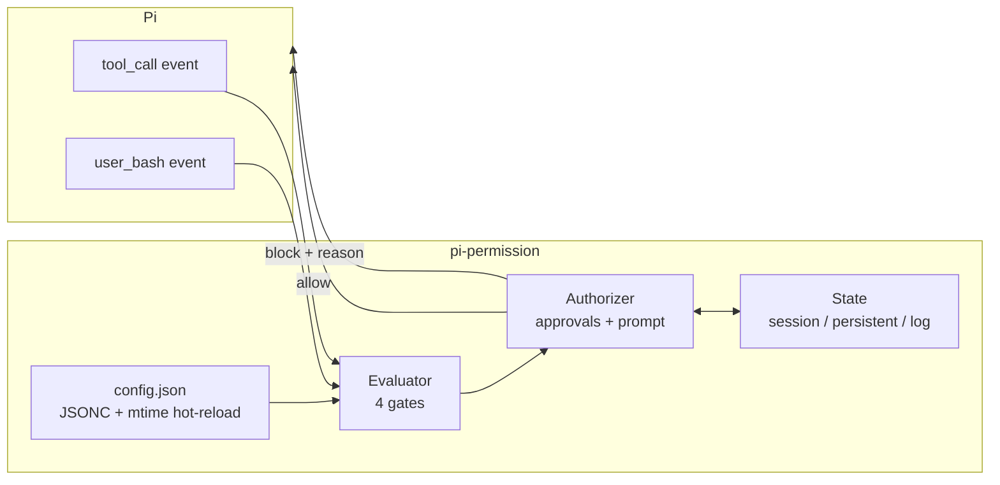
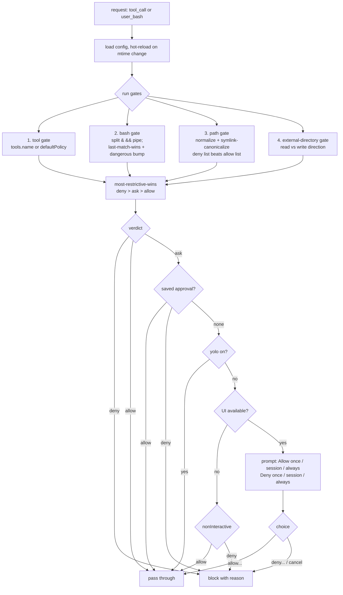
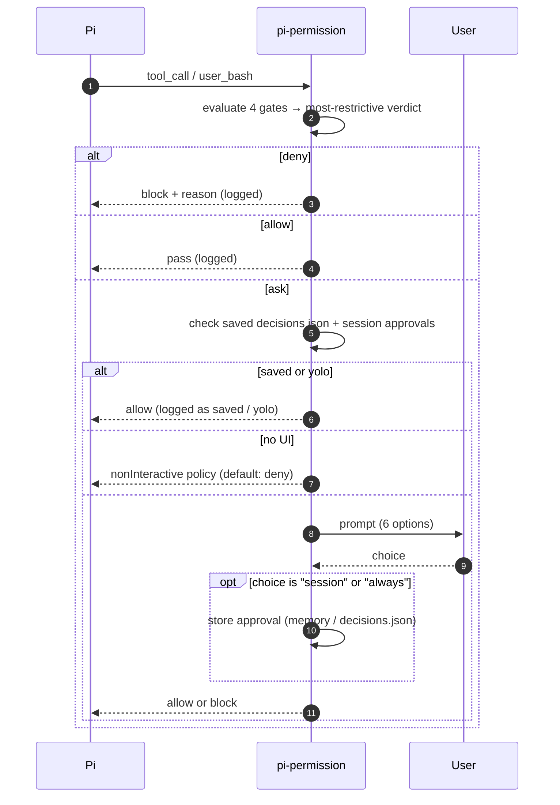

# 🔐 pi-permission

A self-contained permission gate for the [Pi coding agent](https://github.com/earendil-works/pi). It enforces **allow / ask / deny** policy over tools, bash commands, file paths, and the working-directory boundary — with session + persistent approvals, symlink-aware path protection, a "YOLO" mode, fail-closed behavior, and an audit log.

Everything lives in one directory with **zero runtime dependencies**:

```
~/.pi/agent/extensions/pi-permission/
├── index.ts        # the extension (loaded by Pi)
├── deletion-guard.ts # target-aware rm/rmdir checks
├── deletion-guard.test.mjs # policy tests (no shell deletions)
├── config.json     # your policy (JSONC, comments allowed)
├── decisions.json  # generated: persisted allow/deny choices
├── decisions.log   # generated: audit trail
└── README.md       # this file
```

---

## Why this exists

Pi ships two tiny reference extensions (`permission-gate.ts`, `protected-paths.ts`) that are each ~30 lines of hardcoded regex. They work, but they are not a *system*:

- no configuration — you edit code to change behavior
- bash-only danger detection, no path canonicalization, no approvals memory
- no policy for other tools, no boundary between "inside" and "outside" the project
- no fail-closed behavior, no audit trail

The full-featured reference package ([`@gotgenes/pi-permission-system`](https://github.com/gotgenes/pi-packages)) is excellent but large: tree-sitter bash parsing, authorizer chains, subagent forwarding, a TUI modal, thousands of lines across dozens of files.

`pi-permission` is the deliberate middle ground: **smarter than the stock examples, radically simpler than the full reference**. One file, one JSON config, no external deps.

---

## Architecture



The extension subscribes to two Pi events and funnels them through one pipeline. Nothing runs in the factory; all work happens per event.

---

## Decision pipeline

Every request flows through four independent gates, then the **most restrictive** verdict wins (`deny` > `ask` > `allow`).



### The four gates

| Gate | What it decides | Key detail |
|---|---|---|
| **tool** | Is this tool allowed at all? | `tools.<name>` in config, fallback `defaultPolicy` |
| **bash** | Is this shell command allowed? | split on `&&` `\|\|` `;` `\|` newline; **last matching pattern wins**; dangerous regexes bump `allow` → `ask` |
| **path** | Is this file path touchable? | cross-cutting: applies to *all* tools *and* bash; matched against the path as written **and** its symlink-resolved form |
| **external-directory** | May it reach outside `cwd`? | direction-aware: `externalDirectory` (writes) vs `externalDirectoryRead` (reads) |

### Why "most-restrictive-wins"

It is a security property. A broad `"*": "allow"` on tools cannot loosen a `pathDeny` on `~/.ssh/**`; a `bash: {"git *": "allow"}` cannot loosen an `externalDirectory: "deny"`. Every layer can only make the final verdict stricter.

---

## Approval flow



Approvals are keyed by a **signature**:

| Kind | Signature | Example |
|---|---|---|
| tool | `tool:<name>` | `tool:edit` |
| bash | `bash:<unit>` | `bash:git push origin main --force` |
| path | `path:<canonical-path>` | `path:/home/wit/.ssh/id_rsa` |
| external | `external:<canonical-path>` | `external:/etc/hosts` |

**"Allow this session"** lives in memory (cleared on reload). **"Always allow/deny"** persists to `decisions.json`. A saved **deny** always wins; a saved **allow** upgrades `ask` → `allow` but can never override a hard config `deny`.

---

## YOLO mode

Auto-approves ordinary `ask` decisions so the agent runs unattended — while **preserving hard denies**. Outside-project or ambiguous deletion commands require one-time confirmation even in YOLO.

```jsonc
"yoloMode": false   // in config.json
```

```
/yolo                      # toggle
/yolo on
/yolo off

/permissions yolo          # original command still works
/permissions yolo on
/permissions yolo off
```

When on, the footer shows `🔐 yolo`. `.env`, `~/.ssh`, and other `deny` rules **still block**.

### Target-aware deletion

The default recursive `rm` patterns are now `ask`, with an additional guard for `rm` and `rmdir`:

- Literal targets strictly inside the session working directory: prompt normally, auto-approve in YOLO. Simple `cd directory && rm ...` is supported.
- Root `/`, system trees (including `/etc`, `/usr`, `/boot`, `/dev`, `/proc`, `/sys`, `/var`, and `/run`), the entire home directory, project root/ancestors, and top-level shared directories such as `/tmp`: hard deny. Both lexical and symlink-resolved targets are checked.
- Outside-project targets, globs, variables, substitutions, wrappers, unsupported options, or other operations in the same command: one-time confirmation, regardless of YOLO or saved allows. No UI means blocked.
- Sensitive-path denials still apply, including bare targets such as `.env`.

This is conservative shell inspection, **not a sandbox**. Arbitrary scripts, other deletion utilities, mount changes, and filesystem races cannot be comprehensively controlled by this guard. The project boundary is `ctx.cwd`, not an inferred Git root.

Run policy tests with `node --experimental-strip-types --test deletion-guard.test.mjs`. They never execute the example shell commands.

---

## Configuration reference

`config.json` is JSONC (comments + trailing commas allowed). Edits hot-reload automatically, or force with `/permissions reload`.

| Key | Type | Default | Meaning |
|---|---|---|---|
| `defaultPolicy` | `allow`\|`ask`\|`deny` | `allow` | Fallback for tools with no rule |
| `nonInteractive` | `allow`\|`ask`\|`deny` | `deny` | What `ask` becomes when no UI exists |
| `logDecisions` | `boolean` | `true` | Append audit entries to `decisions.log` |
| `yoloMode` | `boolean` | `false` | Auto-approve `ask` (denies still block) |
| `tools` | `{ name: policy }` | `bash: allow, write/edit/append: ask` | Per-tool policy (bash gating lives in `bash` patterns) |
| `bash` | `{ pattern: policy }` | see file | Last matching pattern wins; `*` matches anything |
| `pathDeny` | `glob[]` | secrets list | Cross-cutting deny (all tools + bash) |
| `pathAllow` | `glob[]` | `[]` | Exceptions; deny still wins |
| `externalDirectory` | `allow`\|`ask`\|`deny` | `ask` | Writes/bash reaching outside `cwd` |
| `externalDirectoryRead` | `allow`\|`ask`\|`deny` | `allow` | Reads reaching outside `cwd` |
| `dangerousCommands` | `regex[]` | see file | Force at-least-`ask` even if a rule allows |

**Path globs:** `*` matches within a segment, `**` crosses `/`, `~` expands to home. Matched against both the literal and symlink-resolved path.

**Bash globs:** `*` matches any characters (including spaces). Order matters — later rules override earlier ones.

---

## Commands

| Command | Effect |
|---|---|
| `/permissions status` | Show rules, approvals, yolo state, recent decisions |
| `/permissions reload` | Re-read `config.json` (also clears live yolo override) |
| `/permissions reset` | Clear session + persistent approvals |
| `/permissions yolo [on\|off]` | Toggle or set YOLO mode |
| `/yolo [on\|off]` | Shortcut for `/permissions yolo [on\|off]` |

---

## Design decisions & known tradeoffs

- **Fail closed.** Any internal error blocks the call rather than letting it pass ungated. No silent bypass.
- **Self-guarding.** Editing `config.json` itself prompts (it is an `edit`). An agent must not be able to rewrite its own guardrails silently.
- **Bash parsing is a tokenizer, not tree-sitter.** It handles quotes/escapes/chains but can be fooled by exotic shell syntax (e.g. `$(...)` obfuscation). The dangerous-regex net is the backstop. A full AST parser is the main thing the reference package has that this one deliberately trades away for size.
- **Tool gate is per-name, not per-path.** Today there is no "allow `edit` only for file X" rule — a tool is `ask` everywhere or nowhere (YOLO is the escape hatch). Adding per-tool path patterns is a possible next step.
- **"Session" = until reload.** Session approvals are module-level state, not keyed to Pi's session manager. Simple and predictable, but they survive a session switch within one process.
- **No persistence of "always" decisions into `config.json`.** Persisted choices live in `decisions.json` to keep your hand-edited policy separate from the machine's accumulated rulings (`/permissions reset` clears them).

---

## How it was built (process & workflow)

1. **Read the Pi docs** — `extensions.md`, `packages.md`, `security.md` to learn the exact event contracts (`tool_call` returns `{ block, reason }`, `user_bash` returns `{ result }`, `ctx.ui`, `ctx.cwd`, `ctx.hasUI`).
2. **Started from the stock examples** — copied `permission-gate.ts` + `protected-paths.ts` and ran them to confirm the pipeline works end-to-end (`sudo whoami` → "Blocked by user").
3. **Reviewed the reference** (`@gotgenes/pi-permission-system`) for feature vocabulary: allow/ask/deny, most-restrictive-wins, path canonicalization, external-directory boundary, session/persistent approvals, YOLO mode, fail-closed, status command — then **reimplemented the useful subset** in one file rather than cloning.
4. **Designed the policy model** — four gates → most-restrictive-wins → authorizer.
5. **Implemented** `index.ts` + `config.json` with JSONC parsing, hot reload, and an audit log.
6. **Validated without launching Pi**:
   - `node --experimental-strip-types` import → catches syntax/erasable-TS errors instantly (caught one typo: `function pathGlobCache` vs `const`).
   - JSONC strip + parse of `config.json`.
   - Standalone unit checks of glob matching, bash unit splitting, and policy resolution (all passed).
7. **Iterated on feedback** — added YOLO mode after a real usage request.
8. **Live-tested** — `rm -rf` correctly denied, `sudo whoami` correctly prompted, and the gate demonstrably blocks the agent's *own* tool calls too.

### Validation checklist

| Check | Result |
|---|---|
| `index.ts` parses under Node type-stripping | ✅ |
| `config.json` parses as JSONC | ✅ |
| bash pattern matching (`git status`, `rm -rf *`, `sudo *`, `--force`) | ✅ |
| bash unit splitting across `&&`, `\|`, `;`, newline | ✅ |
| path globs (`**/.env`, `~/.ssh/**`) | ✅ |
| Live: `rm -rf` denied | ✅ |
| Live: `sudo whoami` prompts | ✅ |

---

## Quick test

```bash
/reload                                  # load the extension

/permissions status                      # should print rules + state

# then ask the agent:
#   "rm -rf /"               → denied (no prompt)
#   "rm -rf .beads .agents"   → prompt (project-local)
#   "rm -rf /tmp/x"          → one-time confirmation (outside project)
#   "write FOO=bar to .env"  → denied (path deny)
#   "sudo whoami"            → prompt (ask)
#   "run cat /etc/hostname"  → prompt (ask)

/permissions yolo on
#   re-run "sudo whoami"     → allowed silently
#   "rm -rf .beads .agents"   → allowed silently (project-local)
#   "rm -rf /tmp/x"          → STILL requires one-time confirmation
#   "rm -rf /"               → STILL denied (hard deny survives yolo)
```
